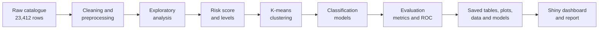
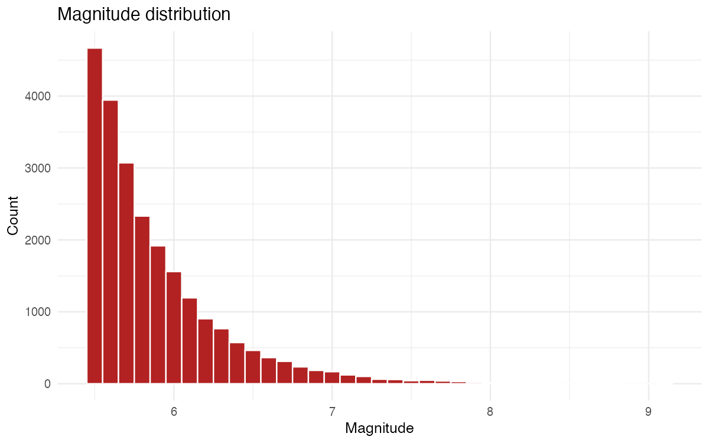
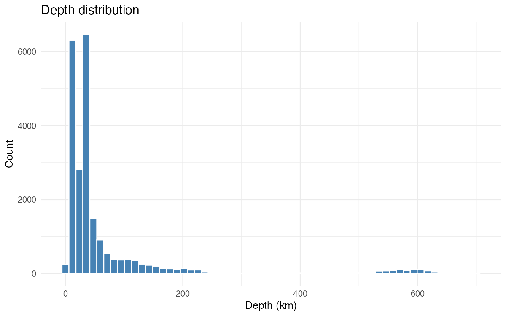
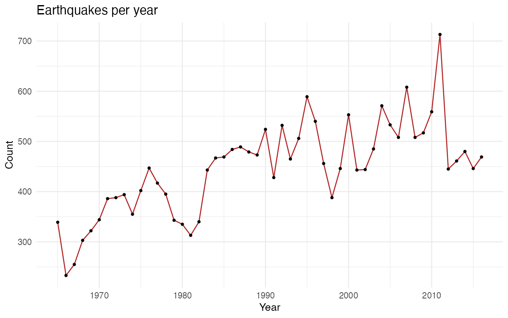
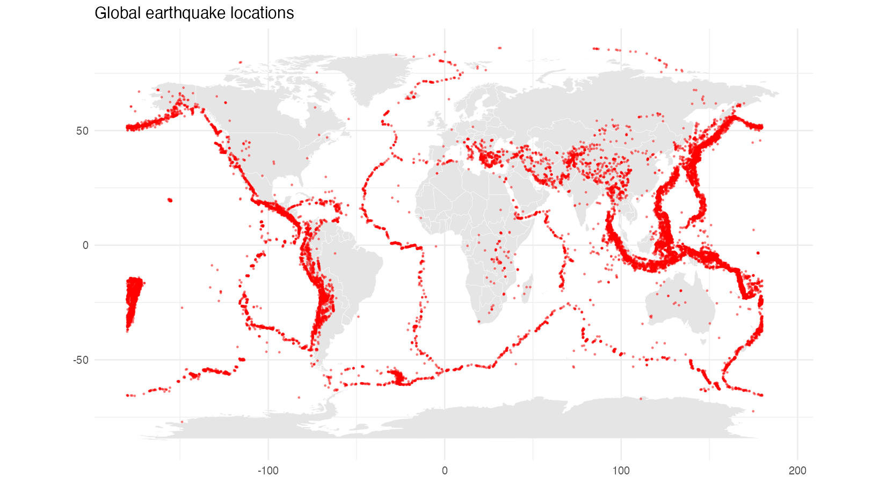
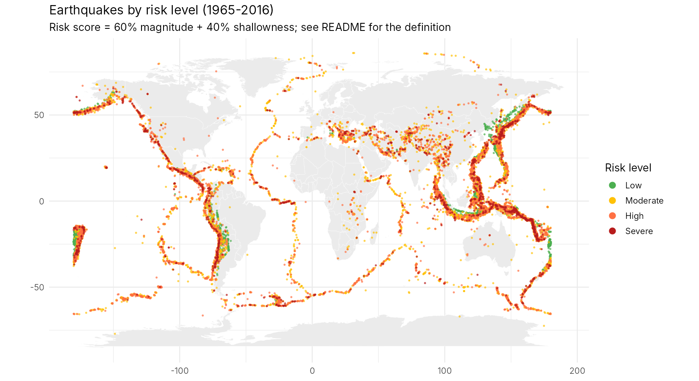
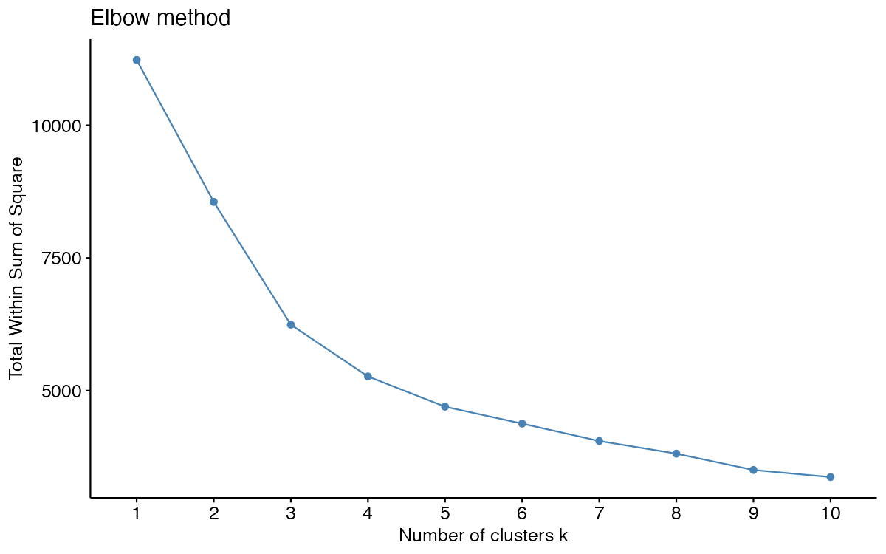
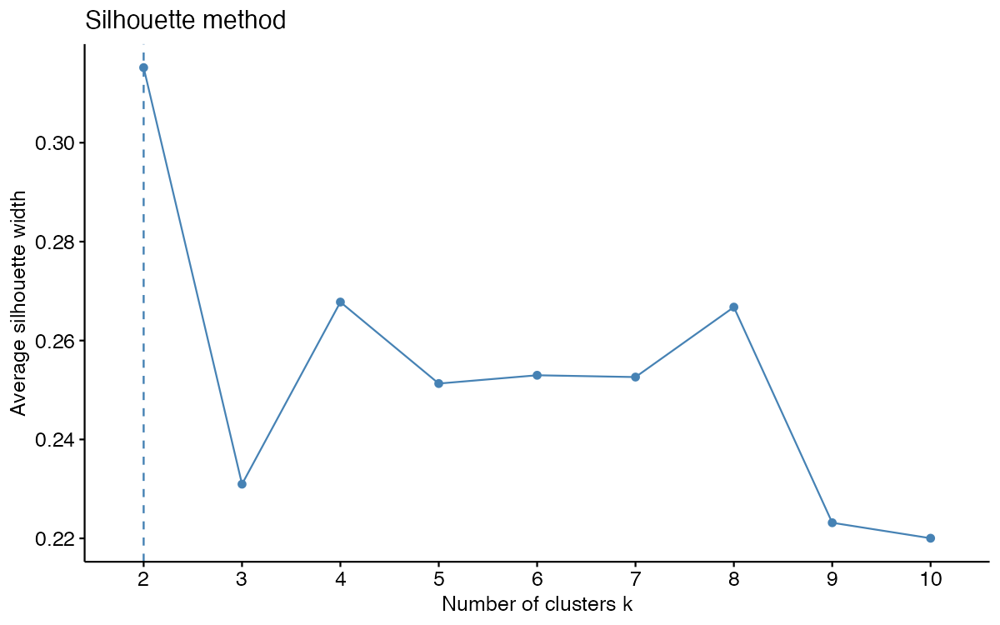
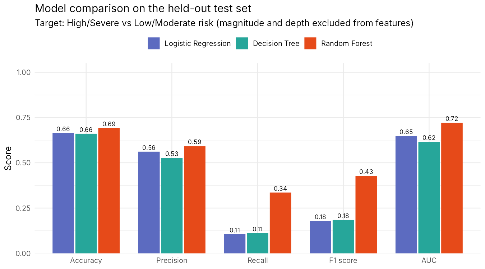
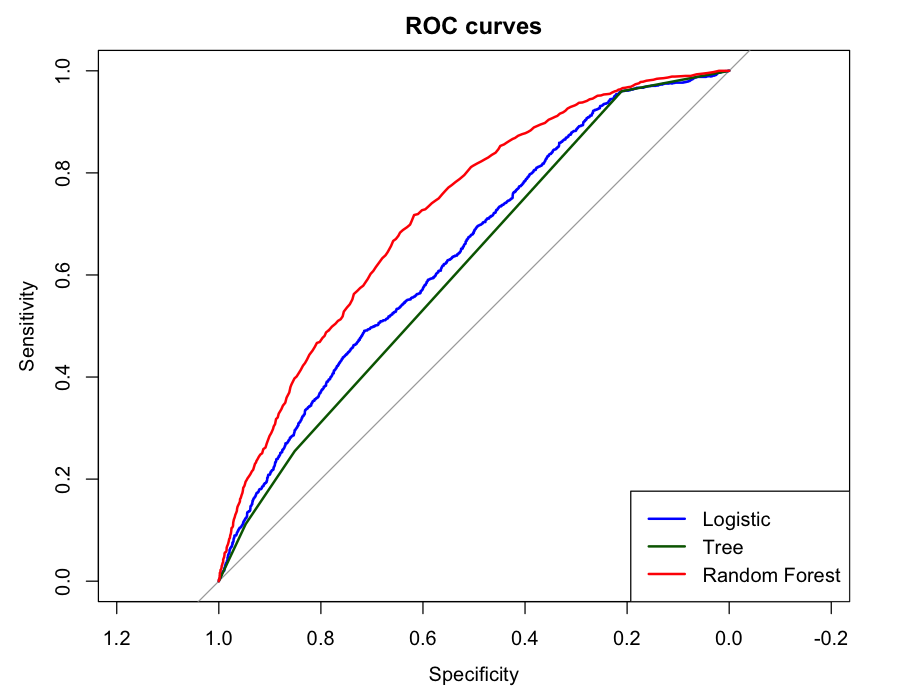

# Global Earthquake Risk Analytics using R

Exploratory analysis, a transparent risk score, clustering, machine learning and an interactive Shiny dashboard for **23,232 significant earthquakes (magnitude 5.5+, 1965-2016)**.

> B.E. Artificial Intelligence and Data Science case study, Chaitanya Bharathi Institute of Technology (CBIT), Hyderabad.

## Quick links

| | | |
|---|---|---|
| **Read** | [Report (PDF)](report/earthquake_report.pdf) | [Report source (R Markdown)](report/earthquake_report.Rmd) |
| **Inspect & reproduce** | [Analysis script](earthquake_analysis.R) | [Dashboard code](app.R) |
| **Data & results** | [Dataset (raw CSV)](data/raw/database.csv) | [Plots](outputs/plots/) / [Tables](outputs/tables/) / [Interactive map](outputs/maps/earthquake_map.html) |
| **Interact** | Live dashboard: **not published yet** (see [Run the dashboard](#run-the-dashboard) and [Publish the dashboard](#publish-the-dashboard-public-https-link)) | |

> The interactive map file is a Leaflet widget. GitHub shows HTML files as source code, so download the repository and open `outputs/maps/earthquake_map.html` in a browser.

---

## Overview and problem statement

Earthquake effects depend on size, depth and location. Large, shallow earthquakes are generally the most dangerous, but a raw catalogue of tens of thousands of events is hard to read. This project turns a public catalogue into a clear picture of global seismic activity and answers four questions:

1. Where and when do significant earthquakes occur, and how are magnitude and depth distributed?
2. Can magnitude and depth be combined into a simple, explainable severity score?
3. Do earthquakes fall into natural groups?
4. How well can machine-learning models recognise High/Severe events from location, time and catalogue information?

**Scope.** The score and models describe recorded events. They are **not** a forecast and do not account for population, buildings or local geology.

## Objectives

- Clean and document a global earthquake catalogue reproducibly in R.
- Explore magnitude, depth, temporal and geographic patterns.
- Define a risk score and four risk levels, and map them.
- Cluster earthquakes (K-means) and interpret the groups.
- Train and compare three classifiers with appropriate metrics.
- Provide an interactive Shiny dashboard and a reproducible repository.

## Dataset

| Item | Details |
|---|---|
| Source | *Significant Earthquakes, 1965-2016* (USGS earthquake database), as distributed on Kaggle: <https://www.kaggle.com/datasets/usgs/earthquake-database>. Original catalogue: [USGS Earthquake Catalog](https://earthquake.usgs.gov/earthquakes/search/). Check the dataset page for its terms of use. |
| File in this repo | [`data/raw/database.csv`](data/raw/database.csv) |
| Raw size | 23,412 rows x 21 columns |
| Period / magnitude | January 1965 - December 2016, magnitude 5.5 to 9.1 |
| Key variables | `Date`, `Time`, `Latitude`, `Longitude`, `Depth` (km), `Magnitude`, `Magnitude Type`, `Type`, `Status`, `ID`, `Source` |
| Filtering | Kept only `Type == "Earthquake"` (removed 4 explosions, 175 nuclear explosions, 1 rock burst = 180 records); 7 columns with more than 60% missing values dropped; 3 negative depths set to 0; 3 ISO-format timestamps parsed separately; no duplicates found |
| Clean size | **23,232 earthquakes** (35 columns including engineered features), saved to [`data/processed/`](data/processed/) |

## Tools

R, RStudio, and the packages `tidyverse`, `lubridate`, `janitor`, `skimr`, `corrplot`, `leaflet`, `htmlwidgets`, `maps`, `caret`, `rpart`, `rpart.plot`, `randomForest`, `pROC`, `cluster`, `factoextra` (analysis); `shiny`, `bslib`, `plotly`, `DT` (dashboard); `rmarkdown`, `knitr`, `kableExtra` (report).

## Methodology



### Exploratory analysis

Most earthquakes are shallow (79.5% are above 70 km, median depth 33 km), the median magnitude is 5.7, and only 3.2% reach magnitude 7 or more. Epicentres trace the plate boundaries.

<p align="center">
  
  
</p>
<p align="center">
  
  
</p>

The yearly count rises from the late 1960s (about +4.4 events per year, p < 0.001). This is probably influenced by improving catalogue completeness and should not be read as a real increase in seismic activity.

### Risk score

Each earthquake gets a score from 0 to 100:

```
risk score = 100 x ( 0.6 x (M - 5.5) / (Mmax - 5.5)  +  0.4 x (1 - min(depth, 300) / 300) )
```

Magnitude has the larger weight (energy released); shallowness adds 40% because shallow events usually shake the surface harder. The weights are a design choice, not engineering values.

| Risk level | Score | Earthquakes | Share |
|---|---|---:|---:|
| Low | up to 30 | 3,375 | 14.5% |
| Moderate | above 30 to 42 | 11,877 | 51.1% |
| High | above 42 to 55 | 6,604 | 28.4% |
| Severe | above 55 | 1,376 | 5.9% |

<p align="center">
  
</p>

### Clustering

K-means (k = 6, `nstart = 25`) on position on the globe (3-D unit-sphere coordinates), log depth and magnitude. **Caveat:** the elbow plot has no sharp bend and the silhouette width is highest at k = 2 (about 0.32; about 0.25 at k = 6), so k = 6 is a descriptive choice rather than a strongly supported one. The clusters differ mainly by depth and magnitude (for example, one cluster holds the deep events with mean depth of about 325 km and the lowest mean risk; another holds the large events with mean magnitude 7.10). See the [report](report/earthquake_report.pdf) for the full profile.

<p align="center">
  
  
</p>

### Machine learning

Task: classify an earthquake as **High/Severe** (34.3% of events, the positive class) or Low/Moderate. Magnitude and depth are **excluded** from the inputs because they define the score (that would be data leakage). Inputs: latitude, longitude, year, month, hour, review status, magnitude type. 80/20 stratified split; logistic regression, decision tree (`rpart`, cp = 0.005) and random forest (300 trees).

| Model | Accuracy | Precision | Recall | F1 | AUC |
|---|---:|---:|---:|---:|---:|
| Logistic Regression | 0.664 | 0.561 | 0.106 | 0.178 | 0.647 |
| Decision Tree | 0.660 | 0.526 | 0.112 | 0.185 | 0.616 |
| **Random Forest** | **0.692** | **0.592** | **0.336** | **0.428** | **0.722** |

A model that always predicts Low/Moderate would score 0.657 accuracy, so the gains are modest: location, time and catalogue information carry some, but limited, information about severity. (Values are from [`outputs/tables/model_comparison.csv`](outputs/tables/model_comparison.csv).)

<p align="center">
  
  
</p>

## Limitations and future improvements

- The risk score is a simple descriptive formula with author-chosen weights; it ignores exposure and local geology.
- The catalogue only has events of magnitude 5.5 and above, and yearly counts are affected by detection and reporting.
- k = 6 is not strongly supported by the elbow and silhouette diagnostics.
- The classifiers are only moderately better than a baseline, and `year` and `magnitude_type` act partly as proxies for magnitude.
- **Reproducibility of the random steps.** A repeat run in a different R environment (R 4.3.3) gave the same data cleaning, risk counts and model ranking (random forest best, F1 about 0.43, AUC about 0.72), but the random split and clustering gave different numbers, and the decision tree collapsed to a single node. Treat the decision-tree scores as fragile; cross-validation would be more reliable.
- The first run did not save confusion matrices. `earthquake_analysis.R` now writes them (`outputs/tables/confusion_matrices.csv`, `outputs/plots/63_confusion_matrices.png`) the next time it is run. Re-running overwrites the saved metric tables and figures with the new run's values, so re-render the report afterwards.

Future work: cross-validation and a saved train/test partition, tuning and boosting, class-imbalance handling, better cluster-number selection (or DBSCAN on the sphere), and exposure data (population, plate boundaries) for a more realistic risk measure.

## Project structure

```
Global-Earthquake-Risk-Analytics/
|-- README.md
|-- earthquake_analysis.R        # full pipeline: cleaning, EDA, risk score, clustering, ML
|-- make_extra_figures.R         # model-comparison chart and risk map (from saved results)
|-- app.R                        # Shiny dashboard
|-- install_packages.R           # installs every required package
|-- deploy_shinyapps.R           # publishes the dashboard to shinyapps.io
|-- Global-Earthquake-Risk-Analytics.Rproj
|-- report/
|   |-- earthquake_report.Rmd    # editable report source
|   `-- earthquake_report.pdf    # generated from the .Rmd
|-- data/
|   |-- raw/database.csv         # original catalogue
|   `-- processed/               # earthquakes_clean.csv / .rds
|-- outputs/
|   |-- plots/                   # all figures (PNG)
|   |-- maps/                    # interactive Leaflet map
|   `-- tables/                  # result tables (CSV)
|-- models/                      # trained models are written here (not tracked in git)
`-- screenshots/                 # dashboard screenshots (to be added)
```

## Reproduce the project (new user)

1. **Open** the repository: <https://github.com/chaithanyakumarreddy57-spec/Global-Earthquake-Risk-Analytics>
2. **Get the code:** click *Code > Download ZIP* and unzip, or run `git clone https://github.com/chaithanyakumarreddy57-spec/Global-Earthquake-Risk-Analytics.git`.
3. **Install** [R](https://cran.r-project.org) (4.3 or newer) and [RStudio](https://posit.co/download/rstudio-desktop/). For the PDF report you also need LaTeX: in R run `install.packages("tinytex"); tinytex::install_tinytex()`.
4. **Open** `Global-Earthquake-Risk-Analytics.Rproj` in RStudio (this sets the working directory to the project root; all paths are relative to it), then install the packages:
   ```r
   source("install_packages.R")
   ```
5. **Dataset:** `data/raw/database.csv` is already included. If you removed it, download *Significant Earthquakes, 1965-2016* from the Kaggle link above and put `database.csv` in `data/raw/` (or put `archive.zip` in the project folder; the script unzips it).
6. **Run the analysis** (several minutes; recreates all tables, plots, the map, cleaned data and models):
   ```r
   source("earthquake_analysis.R")
   source("make_extra_figures.R")
   ```
7. **Launch the dashboard:** see below.
8. **Build the report and inspect results:**
   ```r
   rmarkdown::render("report/earthquake_report.Rmd")
   ```
   then open `report/earthquake_report.pdf`, the images in `outputs/plots/` and the tables in `outputs/tables/`.

Manual steps: installing R/RStudio/LaTeX and (optionally) obtaining the dataset. Everything else is scripted.

## Run the dashboard

With the project folder as working directory (open the `.Rproj`), run:

```r
shiny::runApp()          # or click "Run App" at the top of app.R in RStudio
```

The app prints a local address such as `http://127.0.0.1:xxxx`. **That address only works on your own computer.** To share the dashboard, publish it (next section). The app needs `data/processed/earthquakes_clean.rds` (or the `.csv`) and shows a clear message if it is missing; the *Models* tab shows a notice if the saved result tables are missing.

Dashboard features: sidebar filters (magnitude, depth, year range, risk level, region, cluster) with a reset button; key figures; interactive charts; a map coloured by magnitude or risk level; cluster and region summary tables; model comparison and feature importance; filtered data table with CSV download.

## Publish the dashboard (public HTTPS link)

1. Create a free account at <https://www.shinyapps.io>.
2. In shinyapps.io open *Account > Tokens*, show your secret, and run once in R (use your own values; never commit them):
   ```r
   rsconnect::setAccountInfo(name = "<account>", token = "<token>", secret = "<secret>")
   ```
3. Run `source("deploy_shinyapps.R")`. It uploads only `app.R` and the three data/result files the app needs.
4. When it finishes, R prints the public URL (`https://<account>.shinyapps.io/global-earthquake-risk-analytics/`). Open it in a private browser window to confirm it works, then add the link to the *Quick links* table above.

## Project status

| Item | Status |
|---|---|
| Analysis pipeline, cleaned data, plots, tables, interactive map | Done (committed) |
| README, R Markdown report and PDF | Done; PDF rendered from the `.Rmd` |
| Dashboard code (`app.R`) | Done; server logic tested with a stubbed map widget. The Leaflet map tab was **not** tested in a browser, so check it when you first run the app |
| Public dashboard URL | **Not done** (needs your shinyapps.io account) |
| Dashboard screenshots in `screenshots/` | **Not done** (take them after running the app) |
| Confusion matrices | Added to the script; appear after the script is re-run |
| `renv.lock` | Not created; `install_packages.R` lists the packages instead |

## Author

**C Chaitanya Kumar Reddy** (Roll No. 160124771035)
B.E. Artificial Intelligence and Data Science, Chaitanya Bharathi Institute of Technology (CBIT), Hyderabad.

## References

1. U.S. Geological Survey. Earthquake Hazards Program, Search Earthquake Catalog. <https://earthquake.usgs.gov/earthquakes/search/>
2. *Significant Earthquakes, 1965-2016* (USGS earthquake database), Kaggle.
3. R Core Team. *R: A Language and Environment for Statistical Computing.* <https://www.R-project.org>
4. Wickham, H. et al. (2019). Welcome to the tidyverse. *Journal of Open Source Software*, 4(43), 1686.
5. Breiman, L. (2001). Random forests. *Machine Learning*, 45(1), 5-32.
6. Hartigan, J. A. and Wong, M. A. (1979). Algorithm AS 136: A K-means clustering algorithm. *JRSS Series C*, 28(1), 100-108.
7. Rousseeuw, P. J. (1987). Silhouettes: a graphical aid to the interpretation and validation of cluster analysis. *J. Computational and Applied Mathematics*, 20, 53-65.
8. Kuhn, M. (2008). Building predictive models in R using the caret package. *Journal of Statistical Software*, 28(5).
9. Robin, X. et al. (2011). pROC: an open-source package for R and S+ to analyze and compare ROC curves. *BMC Bioinformatics*, 12, 77.
